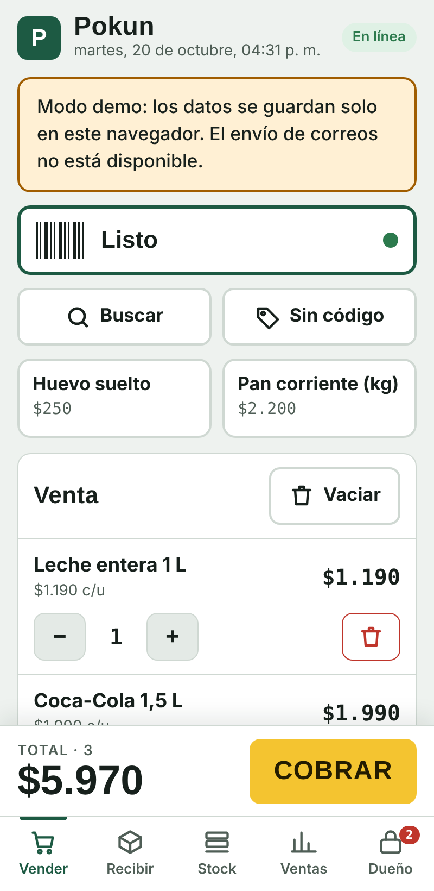
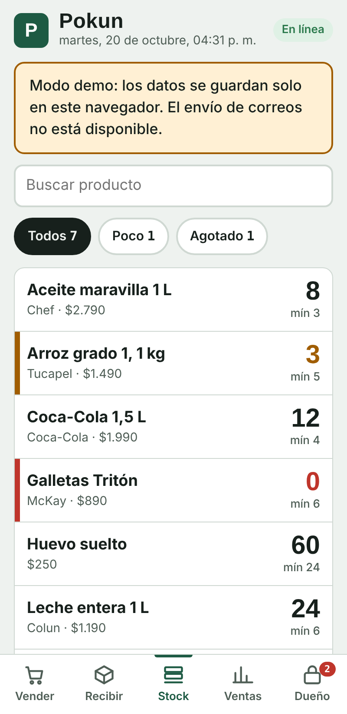

# Pokun — Caja y stock para almacén de barrio

Aplicación web de punto de venta para un almacén de barrio, pensada para usarse desde un teléfono Android con lector de códigos de barras y por una vendedora sin experiencia técnica.

**[Probar la demo](https://eth3rn4l.github.io/pokun-pos/)** — en la demo los datos se guardan solo en tu navegador.

<p>
  
  
</p>

## Funcionalidades

- **Venta con lector de códigos:** el lector "teclea" el código y el producto se agrega al carro con sonido y vibración de confirmación.
- **Cobro** en efectivo (con botones de billetes y cálculo de vuelto), tarjeta o transferencia; anulación de ventas.
- **Productos sin código** (pan, huevos sueltos) con botones rápidos y venta a precio libre.
- **Recepción de mercadería** escaneando lo que llega, para sumar stock.
- **Stock** con alertas de productos bajos o agotados.
- **Resumen del día:** total vendido, efectivo en caja, ventas por producto y detalle de tickets.
- **Panel del dueño** protegido con clave: inventario, importación y exportación de planillas Excel con vista previa de cambios.
- **Avisos por correo** de stock bajo y resumen diario (vía Gmail, solo en la versión conectada).
- Pensada para el uso diario: botones grandes, pantalla siempre encendida, aviso cuando no hay internet, modo oscuro.

## Tecnologías

HTML, CSS y JavaScript sin frameworks · SheetJS (xlsx) para planillas · Web Audio, Vibration y Wake Lock API.

La versión en uso guarda los datos en una base de datos compartida en la nube, para que el dueño y la vendedora vean lo mismo en tiempo real. Esta demo incluye un adaptador que imita esa misma API sobre `localStorage`, así que se puede probar sin cuenta.

## Ejecutar localmente

Basta con abrir `index.html` en el navegador o servir la carpeta:

```bash
npx serve .
```
